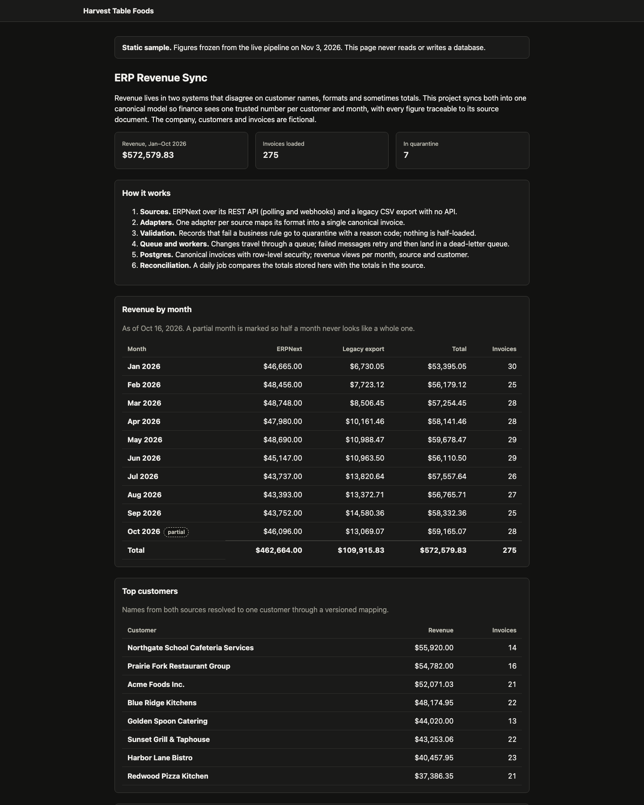

# ERP Revenue Sync

Revenue for one fictional company, Harvest Table Foods, lives in two systems that disagree on customer names, formats and sometimes totals: an ERPNext instance with a REST API and a legacy CSV export with no API. This project syncs both into one canonical model so finance sees one trusted revenue figure per customer and month, and every figure traces back to its source document.

**Live demo:** https://erp-sync-lab.vercel.app — a static sample with figures frozen from the running pipeline. The public site never reads or writes a database.



## How it works

1. **Sources.** ERPNext over its REST API (incremental polling on a `(modified, name)` cursor, plus webhooks) and a legacy CSV export.
2. **Adapters.** One adapter per source maps its format into a single canonical invoice (`src/core/adapters/`).
3. **Validation.** Records that break a business rule go to quarantine with a reason code; nothing is half-loaded (`src/core/validation/`).
4. **Queue and workers.** Changes travel through a Postgres queue (pgmq); failed messages retry and then land in a dead-letter queue (`supabase/functions/`).
5. **Postgres.** Canonical invoices with row-level security, revenue views per month, source and customer (`supabase/migrations/`).
6. **Reconciliation.** A daily job compares the totals stored here with the totals in ERPNext.
7. **Dashboard.** Next.js pages over thin API routes; Google sign-in with an allowlist.

## How it was built: spec-driven

The specs come first and the code answers to them. Flow diagram: [`specs/fluxo.drawio`](specs/fluxo.drawio).

| Step | Document |
|---|---|
| Constitution: principles every decision must respect | [`specs/CONSTITUTION.md`](specs/CONSTITUTION.md) |
| Specification: what and why, with requirements (R), business rules (BR), edge cases (EC) and acceptance criteria (AC) | [`specs/SPEC.md`](specs/SPEC.md) |
| Clarification: open questions answered before planning | `specs/SPEC.md`, section "Open questions (Q)" |
| Plan: how | [`specs/PLAN.md`](specs/PLAN.md) |
| Tasks: small and verifiable | [`specs/TASKS.md`](specs/TASKS.md) |
| Analysis: acceptance criteria × tasks × tests | [`specs/ANALYSIS.md`](specs/ANALYSIS.md) |
| Deploy | [`specs/DEPLOY.md`](specs/DEPLOY.md) |

## Run it locally

Requires Node 24+, Docker and the Supabase CLI.

```bash
npm install
npm run db:start        # local Supabase stack (Docker)
npm run db:reset        # applies the migrations
npm test                # unit tests in src/; SQL tests in tests/sql need the local stack
npm run dev             # then open http://localhost:3000/demo, no configuration needed
```

- **The demo page** (`/demo`) works with no configuration: it renders `app/demo/snapshot.json`.
- **The legacy CSV source** works offline: `npm run legacy:csv` generates the fictional exports in `data/`.
- **The ERPNext source** needs your own ERPNext instance: copy `.env.example` to `.env`, fill in the ERPNext and Supabase values, then `npm run seed:erp` loads the fictional invoices. Webhook setup: [`docs/erpnext-webhook.md`](docs/erpnext-webhook.md).
- **The signed-in dashboard** (`npm run dev:local` against the local stack) needs a Google OAuth client enabled in `supabase/config.toml` and your account on the allowlist (`scripts/ops/set-allowlist.ts`).
- `DEMO_ONLY=true` turns any deployment into the public demo: every page goes to `/demo`, and `/api` and `/auth` answer 404.

## Stack

TypeScript · Next.js · Supabase (Postgres, pgmq, pg_cron, Edge Functions, row-level security) · Jest · Vercel
